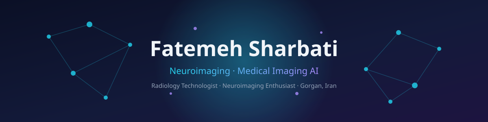

  

**Radiology graduate building open tools for neuroimaging — from DICOM to deep learning.**

Brain MRI preprocessing · Tumor segmentation · Medical vision-language models · Reproducible research

  

---

## What I'm building

- **Brain MRI preprocessing pipelines.** N4 bias correction, intensity normalization, registration and QC reports — reproducible, tested, documented.
- **Segmentation, benchmarked honestly.** Tumor segmentation on BraTS and anatomical segmentation benchmarks with Dice / HD95 and visual QC.
- **Unsupervised anomaly detection.** Autoencoder-based lesion highlighting in brain MRI — no labels required.
- **Vision-language models for radiology.** CLIP-style image–text retrieval demos plus subgroup fairness audits, because medical AI must be audited, not just trained.

---

**Capabilities, and the proof**

| Capability | Proof |
| --- | --- |
| Brain MRI preprocessing (N4, normalization, registration, QC) | [brain-mri-preprocessing-pipeline](https://github.com/FatemehSharbati/brain-mri-preprocessing-pipeline) |
| Segmentation benchmarking (Dice, HD95, TotalSegmentator / SynthSeg) | [anatomical-seg-benchmark-qc](https://github.com/FatemehSharbati/anatomical-seg-benchmark-qc) |
| Brain tumor segmentation (nnU-Net, MONAI, BraTS WT/TC/ET) | [brats-tumor-segmentation-nnunet](https://github.com/FatemehSharbati/brats-tumor-segmentation-nnunet) |
| Unsupervised anomaly detection (autoencoders, brain MRI) | [unsupervised-mri-anomaly-detection](https://github.com/FatemehSharbati/unsupervised-mri-anomaly-detection) |
| Medical vision-language models + fairness auditing | [radiology-mini-vlm](https://github.com/FatemehSharbati/radiology-mini-vlm) |

---

## Featured projects

| Project | Project |
| --- | --- |
| **[brain-mri-preprocessing-pipeline](https://github.com/FatemehSharbati/brain-mri-preprocessing-pipeline)** Reproducible T1 brain MRI preprocessing: N4 bias-field correction, z-score normalization, isotropic resampling, optional template registration — plus a slice-montage QC report.  **Python · SimpleITK · nibabel · matplotlib** | **[anatomical-seg-benchmark-qc](https://github.com/FatemehSharbati/anatomical-seg-benchmark-qc)** Honest benchmarking harness for anatomical segmentation tools (TotalSegmentator, SynthSeg): per-label Dice, HD95, volume similarity and overlay visualizations.  **Python · NumPy · SciPy · nibabel** |
| **[brats-tumor-segmentation-nnunet](https://github.com/FatemehSharbati/brats-tumor-segmentation-nnunet)** Brain tumor segmentation on BraTS: raw-data converter for nnU-Net v2, MONAI SegResNet training, and WT / TC / ET Dice evaluation.  **Python · PyTorch · MONAI · nnU-Net** | **[unsupervised-mri-anomaly-detection](https://github.com/FatemehSharbati/unsupervised-mri-anomaly-detection)** Convolutional autoencoders trained on healthy brain MRI; lesions surface as reconstruction-error anomaly maps. No labels needed.  **Python · PyTorch · scikit-learn** |
| **[radiology-mini-vlm](https://github.com/FatemehSharbati/radiology-mini-vlm)** Educational CLIP-style text-to-image retrieval for radiology, plus a subgroup fairness audit (per-group AUROC with bootstrap CIs).  **Python · open-CLIP · pandas · scikit-learn** | *More coming —* this profile is built in public, one project at a time. |

---

## GitHub stats

  
  

